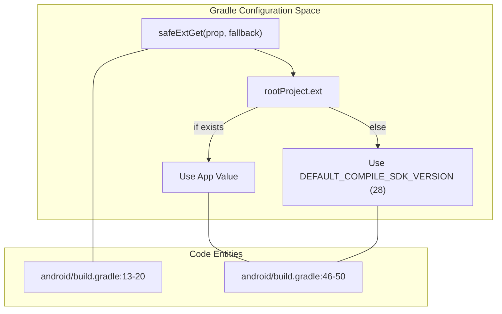
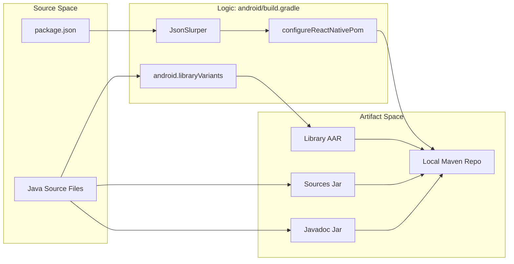

# Android Build Configuration

# Android Build Configuration

Relevant source files

The following files were used as context for generating this wiki page:

- [android/README.md](android/README.md)
- [android/build.gradle](android/build.gradle)
- [android/src/main/AndroidManifest.xml](android/src/main/AndroidManifest.xml)

This page details the Android build system for the `react-native-onfido` library. The configuration is primarily managed through `android/build.gradle`, which defines the SDK requirements, external dependencies (specifically the Onfido Capture SDK), and the local Maven artifact pipeline.

## Build Script Overview

The build configuration follows standard React Native library patterns, utilizing the `com.android.library` plugin. It is designed to work both as an autolinked module within a larger React Native project and as a standalone project for development.

### SDK Versioning and Safe Access
The project defines default SDK versions but uses a `safeExtGet` helper function to allow consuming applications to override these values via their `rootProject.ext` properties.

| Property | Default Value | Description |
| :--- | :--- | :--- |
| `compileSdkVersion` | 28 | The SDK version used to compile the Java code. |
| `minSdkVersion` | 16 | The minimum Android version supported (Android 4.1). |
| `targetSdkVersion` | 28 | The Android version the library is optimized for. |
| `buildToolsVersion` | 28.0.3 | The version of the Android SDK build tools. |

**Code Entity Mapping: SDK Configuration**

**Sources:** [android/build.gradle:13-20](), [android/build.gradle:46-50]()

---

## Dependency Management

The library relies on several key external dependencies to facilitate identity verification and networking.

### Core Dependencies
*   **Onfido Capture SDK (`7.0.0`)**: The primary native SDK for document and face capture [android/build.gradle:79]().
*   **React Native**: Included as a `+` version dependency to ensure compatibility with the host application's version [android/build.gradle:78]().
*   **OkHttp (`4.9.3`)**: Used for networking and includes a `logging-interceptor` for debugging network traffic [android/build.gradle:80-81]().
*   **MultiDex (`2.0.1`)**: Included to support applications that exceed the 64K method limit, common when integrating large SDKs like Onfido [android/build.gradle:82]().

### Camera Compatibility
To prevent build failures related to missing dimensions in dependent camera libraries, the configuration explicitly sets a `missingDimensionStrategy` for `react-native-camera` to `general` [android/build.gradle:53]().

**Sources:** [android/build.gradle:76-83](), [android/build.gradle:53]()

---

## Maven Artifact Pipeline

The library includes a sophisticated local Maven publication pipeline. This allows the library to be packaged as an AAR (Android Archive) with associated Javadoc and source jars.

### Metadata Synchronization
The `configureReactNativePom` function parses the root `package.json` file to automatically synchronize Android artifact metadata (version, name, description, author) with the JavaScript package metadata [android/build.gradle:85-111]().

### Build Tasks
The `afterEvaluate` block defines several custom tasks for artifact generation:
*   **`androidJavadoc`**: Generates Javadoc from the Java source files [android/build.gradle:116-121]().
*   **`androidSourcesJar`**: Packages the Java source code into a JAR file [android/build.gradle:128-132]().
*   **`installArchives`**: Deploys the generated artifacts to a local Maven repository located at `../android/maven` [android/build.gradle:148-155]().

**Data Flow: Metadata and Artifact Generation**

**Sources:** [android/build.gradle:85-111](), [android/build.gradle:113-156](), [android/README.md:1-15]()

---

## Android Manifest Requirements

The library's `AndroidManifest.xml` declares the necessary permissions for the Onfido SDK to function correctly. While some permissions are optional depending on the specific Onfido flow (e.g., video recording), they are defined in the library manifest to be merged into the main application.

| Permission | Requirement | Purpose |
| :--- | :--- | :--- |
| `android.permission.INTERNET` | Required | Communication with Onfido API. |
| `android.permission.CAMERA` | Required | Document and face capture. |
| `android.permission.READ_EXTERNAL_STORAGE` | Optional | Accessing camera roll/gallery. |
| `android.permission.WRITE_EXTERNAL_STORAGE` | Optional | Saving captured media. |
| `android.permission.RECORD_AUDIO` | Optional | Required for video-based selfie checks. |

**Sources:** [android/src/main/AndroidManifest.xml:1-16]()

---