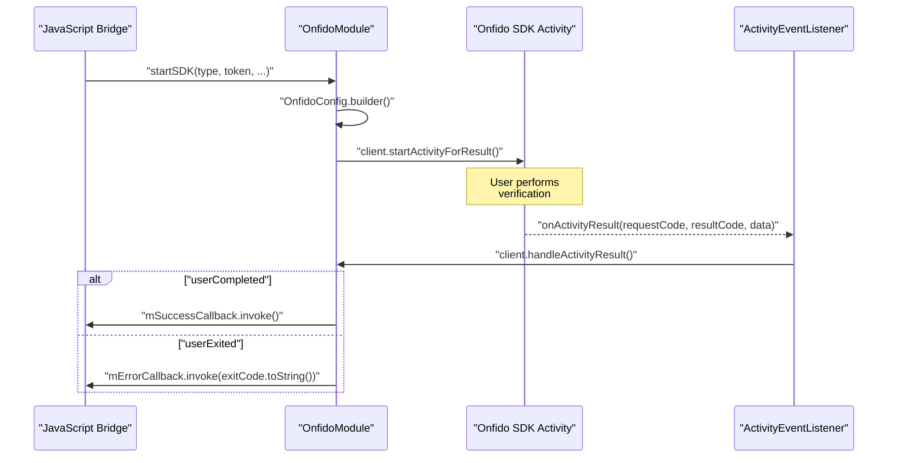
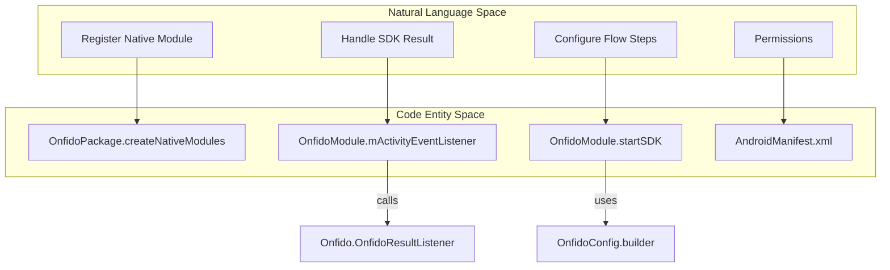

# Android Native Module

# Android Native Module

Relevant source files

The following files were used as context for generating this wiki page:

- [android/src/main/AndroidManifest.xml](android/src/main/AndroidManifest.xml)
- [android/src/main/java/com/reactlibrary/OnfidoModule.java](android/src/main/java/com/reactlibrary/OnfidoModule.java)
- [android/src/main/java/com/reactlibrary/OnfidoPackage.java](android/src/main/java/com/reactlibrary/OnfidoPackage.java)

The Android implementation of the Onfido bridge is centered around `OnfidoModule.java`. This module acts as the glue between the React Native JavaScript environment and the Onfido Android SDK, managing the lifecycle of the verification flow, handling activity results, and routing callbacks back to the JS layer.

## Module Registration

The native module is registered with React Native via the `OnfidoPackage` class. This class implements `ReactPackage` and includes `OnfidoModule` in the list of native modules provided to the `ReactApplicationContext`.

*   **Class:** `OnfidoPackage` [android/src/main/java/com/reactlibrary/OnfidoPackage.java:13-13]()
*   **Method:** `createNativeModules` instantiates `OnfidoModule` [android/src/main/java/com/reactlibrary/OnfidoPackage.java:15-17]()

## OnfidoModule Implementation

`OnfidoModule` extends `ReactContextBaseJavaModule` to expose its functionality to JavaScript under the name `"Onfido"`.

### Initialization and Activity Listening
Upon instantiation, the module creates an Onfido client using `OnfidoFactory` and registers an `ActivityEventListener`. This listener is critical for intercepting the result of the Onfido Activity once the user completes or exits the flow.

*   **Client Creation:** Uses `OnfidoFactory.create(reactContext).getClient()` [android/src/main/java/com/reactlibrary/OnfidoModule.java:68-68]().
*   **Event Registration:** Adds `mActivityEventListener` to the `reactContext` [android/src/main/java/com/reactlibrary/OnfidoModule.java:69-69]().

### The startSDK Method
The primary entry point from JavaScript is the `@ReactMethod startSDK`. This method handles the configuration of the Onfido flow based on the provided parameters.

**Signature:**
`public void startSDK(String type, String token, String applicantId, String countryCode, String primaryColor, Callback successCallback, Callback errorCallback)` [android/src/main/java/com/reactlibrary/OnfidoModule.java:78-78]()

#### Flow Type Branching
The module supports three distinct flow types, which determine the sequence of `FlowStep` objects used in the `OnfidoConfig`:

| Type | Steps Included | Code Reference |
| :--- | :--- | :--- |
| `full` | `DocumentType.NATIONAL_IDENTITY_CARD` + `FaceCaptureVariant.PHOTO` | [android/src/main/java/com/reactlibrary/OnfidoModule.java:92-96]() |
| `selfie` | `FaceCaptureStep` (Photo variant) with intro disabled | [android/src/main/java/com/reactlibrary/OnfidoModule.java:104-110]() |
| `document` | `DocumentType.NATIONAL_IDENTITY_CARD` only | [android/src/main/java/com/reactlibrary/OnfidoModule.java:117-120]() |

#### Configuration Details
*   **Locale:** The module currently hardcodes the locale to Spanish (`new Locale("es", "ES")`) [android/src/main/java/com/reactlibrary/OnfidoModule.java:101-101]().
*   **Country Code:** Uses `CountryCode.valueOf(countryCode)` to set the document issuance country [android/src/main/java/com/reactlibrary/OnfidoModule.java:94-94]().
*   **Execution:** The flow is launched via `client.startActivityForResult(currentActivity, 1, onfidoConfig)` [android/src/main/java/com/reactlibrary/OnfidoModule.java:128-128]().

**Sources:** [android/src/main/java/com/reactlibrary/OnfidoModule.java:78-134]()

## Data Flow and Callback Routing

The following diagram illustrates the interaction between the React Native Bridge, the `OnfidoModule`, and the underlying Onfido SDK.

### SDK Execution and Result Handling
Title: Android Native Flow and Result Handling

**Sources:** [android/src/main/java/com/reactlibrary/OnfidoModule.java:42-63](), [android/src/main/java/com/reactlibrary/OnfidoModule.java:128-128]()

### Callback Logic
The `mActivityEventListener` captures the result of the activity and passes it to `client.handleActivityResult`. This triggers one of the following callbacks:
1.  **`userCompleted`**: Invokes the `mSuccessCallback` [android/src/main/java/com/reactlibrary/OnfidoModule.java:48-50]().
2.  **`userExited`**: Invokes the `mErrorCallback` with the string representation of the `ExitCode` [android/src/main/java/com/reactlibrary/OnfidoModule.java:53-55]().

## Component Mapping

The following diagram maps high-level system requirements to specific code entities within the Android implementation.

Title: Android System Entity Mapping

**Sources:** [android/src/main/java/com/reactlibrary/OnfidoPackage.java:15-17](), [android/src/main/java/com/reactlibrary/OnfidoModule.java:42-42](), [android/src/main/java/com/reactlibrary/OnfidoModule.java:78-78](), [android/src/main/AndroidManifest.xml:4-15]()

## Permissions and Configuration

The `AndroidManifest.xml` defines the necessary permissions for the Onfido SDK to function correctly on Android.

| Permission | Purpose |
| :--- | :--- |
| `android.permission.CAMERA` | Required for document and face capture [android/src/main/AndroidManifest.xml:8-8]() |
| `android.permission.INTERNET` | Required for uploading captures to Onfido servers [android/src/main/AndroidManifest.xml:4-4]() |
| `android.permission.RECORD_AUDIO` | Optional: Required for video recording flows [android/src/main/AndroidManifest.xml:15-15]() |
| `READ_EXTERNAL_STORAGE` | Optional: Required for camera roll access [android/src/main/AndroidManifest.xml:11-12]() |

**Sources:** [android/src/main/AndroidManifest.xml:1-16]()

---