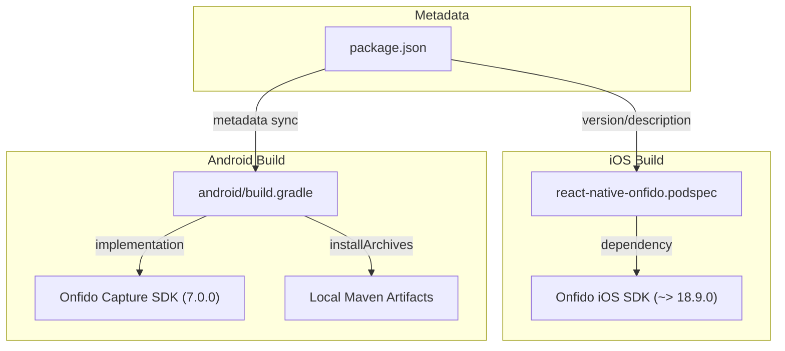
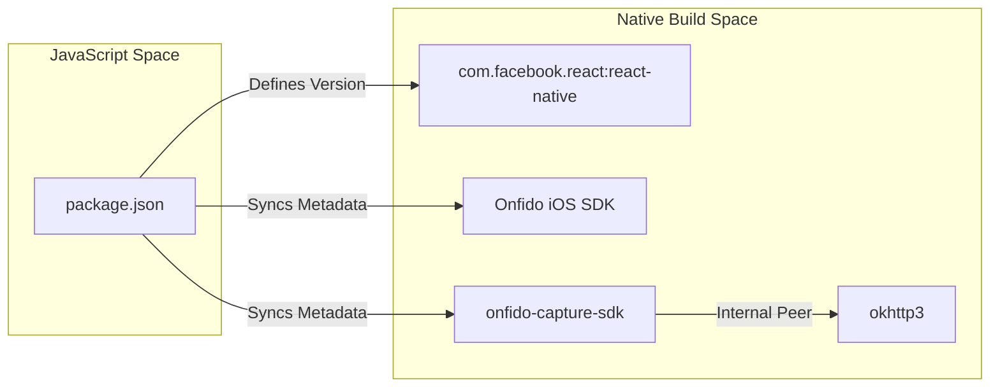

# Build & Configuration

# Build & Configuration

Relevant source files

The following files were used as context for generating this wiki page:

- [android/build.gradle](android/build.gradle)
- [react-native-onfido.podspec](react-native-onfido.podspec)

The `react-native-onfido` library utilizes standard React Native build systems to bridge the JavaScript environment with native Onfido SDKs. This page provides a high-level overview of the dependency management, SDK version pinning, and metadata synchronization for both iOS and Android platforms.

The build system is designed to be consumed as a standard npm package, leveraging CocoaPods for iOS and Gradle for Android. It ensures that the native Onfido SDKs are correctly linked and configured with the necessary permissions and versions required for stable operation.

### Build System Relationship

The following diagram illustrates how the build configuration files interact with the package metadata and native SDKs.

**Build System Entity Map**

Sources: [react-native-onfido.podspec:1-25](), [android/build.gradle:76-111]()

---

### iOS Configuration

The iOS build is managed via a CocoaPods specification (`.podspec`). It defines the environment requirements, such as a minimum iOS deployment target of **10.0** [react-native-onfido.podspec:16-16]() and the use of **Swift 4.2** [react-native-onfido.podspec:17-17]().

Key aspects of the iOS build include:
*   **SDK Pinning**: The library depends on the native `Onfido` pod, pinned to version `~> 18.9.0` [react-native-onfido.podspec:24-24]().
*   **Source Management**: It automatically includes all headers, implementation files, and Swift files within the `ios/` directory [react-native-onfido.podspec:20-20]().
*   **Metadata Sync**: The podspec dynamically reads its version and summary from the root `package.json` [react-native-onfido.podspec:1-8]().

For details on Swift versioning, ARC requirements, and pod dependencies, see [iOS Build Configuration](#3.1).

Sources: [react-native-onfido.podspec:1-25]()

---

### Android Configuration

The Android build uses Gradle to manage the library lifecycle. It is configured as a standard Android Library project (`com.android.library`) [android/build.gradle:22-22]().

Key aspects of the Android build include:
*   **SDK Pinning**: The library implements the `com.onfido.sdk.capture:onfido-capture-sdk` version **7.0.0** [android/build.gradle:79-79]().
*   **Flexible Defaults**: It uses a `safeExtGet` helper function to allow parent projects to override `compileSdkVersion`, `minSdkVersion`, and `targetSdkVersion` [android/build.gradle:18-20](), defaulting to API 28 [android/build.gradle:13-16]().
*   **Networking & Compatibility**: Includes `OkHttp` for networking [android/build.gradle:80-81]() and configures a `missingDimensionStrategy` for `react-native-camera` compatibility [android/build.gradle:53-53]().
*   **Distribution Tooling**: Contains tasks for generating Javadoc and source jars, as well as an `installArchives` task to deploy artifacts to a local Maven repository [android/build.gradle:116-156]().

For details on Gradle hooks, multidex setup, and POM generation, see [Android Build Configuration](#3.2).

Sources: [android/build.gradle:13-156]()

---

### Dependency Flow

The library acts as a middleman, ensuring that the React Native environment is compatible with the specific requirements of the Onfido native components.

**Code Entity Dependency Flow**

Sources: [react-native-onfido.podspec:1-25](), [android/build.gradle:76-111]()

---