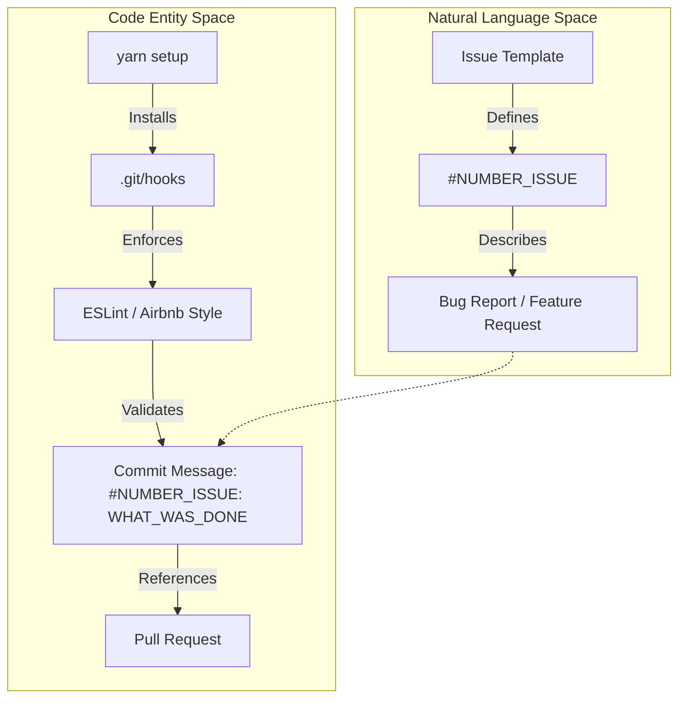
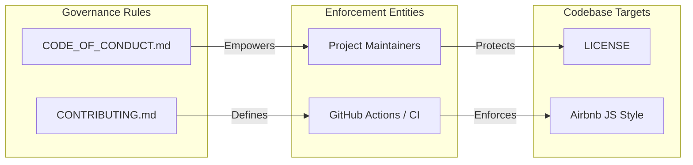

# Contributing & Community

# Contributing & Community

Relevant source files

The following files were used as context for generating this wiki page:

- [.github/CODE_OF_CONDUCT.md](.github/CODE_OF_CONDUCT.md)
- [.github/CONTRIBUTING.md](.github/CONTRIBUTING.md)

This page provides an overview of how to engage with the `react-native-onfido` project. We welcome contributions ranging from bug reports and documentation improvements to feature implementations. The project maintains high standards for code quality and community interaction to ensure a stable and inclusive environment for all developers.

## Project Governance & Workflow

The project follows a structured contribution workflow to maintain the integrity of the React Native bridge. This includes mandatory linting via the Airbnb JavaScript Style Guide and a specific commit message convention to link changes to tracked issues.

### Contribution Process
Before submitting code, contributors are required to initialize their environment using `yarn setup`, which configures local git hooks for pre-commit validation. All changes should be submitted via Pull Requests that reference a specific issue number.

For detailed instructions on environment setup, style guides, and PR requirements, see the [Contribution Guide](#5.1).

### Community Standards
We are committed to providing a welcoming and harassment-free experience for everyone. We have adopted the Contributor Covenant v1.4 to guide our community interactions. Maintainers are responsible for enforcing these standards across all project spaces, including GitHub issues, pull requests, and the wiki.

For details on expected behaviors and reporting procedures, see the [Code of Conduct](#5.2).

## Workflow Integration

The following diagram illustrates how the contribution workflow bridges the gap between natural language requirements (Issues) and the physical codebase (Commits/PRs).

**Contribution Lifecycle: Issue to Code**

**Sources:** [.github/CONTRIBUTING.md:10-24](), [.github/CONTRIBUTING.md:15-17]()

## Project Communication

We use GitHub as the primary hub for all technical and community communication. The interaction between community members and maintainers is governed by the standards set in our documentation.

| Entity | Role | Reference |
|:---|:---|:---|
| **Maintainers** | Clarify standards, take corrective action, and manage PRs. | [.github/CODE_OF_CONDUCT.md:36-44]() |
| **Contributors** | Follow style guides, use issue templates, and uphold the pledge. | [.github/CONTRIBUTING.md:1-13]() |
| **Issue Tracker** | Central location for problem descriptions and feature requests. | [.github/CONTRIBUTING.md:10-13]() |
| **Reporting** | Direct contact for Code of Conduct violations (jamesjara@agmail.com). | [.github/CODE_OF_CONDUCT.md:57-62]() |

**Governance and Enforcement Mapping**

**Sources:** [.github/CODE_OF_CONDUCT.md:40-45](), [.github/CONTRIBUTING.md:17-25](), [.github/CONTRIBUTING.md:27-28]()

---

### Related Pages
*   **[Contribution Guide](#5.1)**: Technical details on `yarn setup`, git hooks, and PR requirements.
*   **[Code of Conduct](#5.2)**: Full text of the Contributor Covenant and enforcement policies.

**Sources:**
- [.github/CODE_OF_CONDUCT.md:1-77]()
- [.github/CONTRIBUTING.md:1-28]()

---