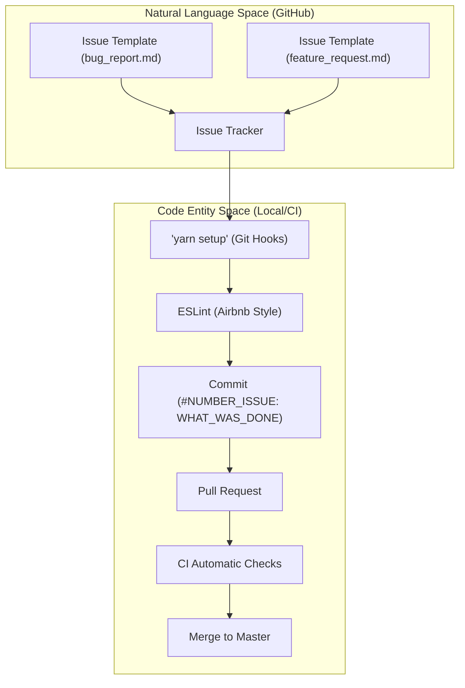
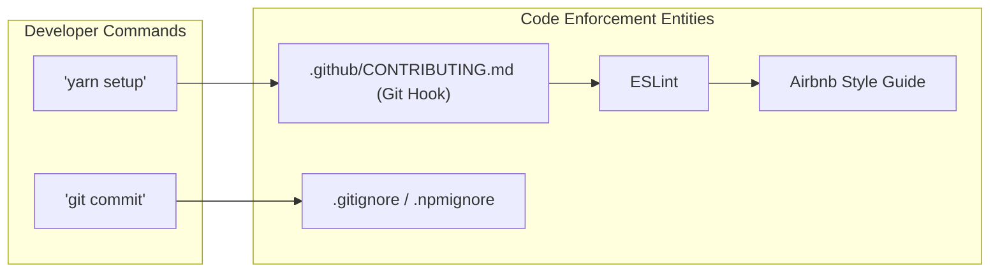

# Contribution Guide

# Contribution Guide

<details>
<summary>Relevant source files</summary>

The following files were used as context for generating this wiki page:

- [.gitattributes](.gitattributes)
- [.github/CONTRIBUTING.md](.github/CONTRIBUTING.md)
- [.github/ISSUE_TEMPLATE/bug_report.md](.github/ISSUE_TEMPLATE/bug_report.md)
- [.github/ISSUE_TEMPLATE/feature_request.md](.github/ISSUE_TEMPLATE/feature_request.md)
- [.gitignore](.gitignore)
- [.npmignore](.npmignore)

</details>


This page details the contribution workflow for the `react-native-onfido` library. It covers environment setup, coding standards, issue management, and the lifecycle of a pull request.

## Development Environment Setup

To ensure a consistent development environment and high code quality, the project utilizes `yarn` for package management and automated git hooks.

### Initial Setup
Before starting development, contributors must run the setup command:
```bash
yarn setup
```
This command is responsible for installing a git hook that performs automated code checks before any commit is finalized [ .github/CONTRIBUTING.md:14-15]().

### Coding Standards
The project strictly enforces the **Airbnb JavaScript Style Guide**.
*   **ESLint**: Used to highlight style violations directly in the IDE [ .github/CONTRIBUTING.md:17-17]().
*   **Automation**: The git hooks installed during `yarn setup` ensure that code not meeting these standards cannot be committed to the repository [ .github/CONTRIBUTING.md:15-15]().

**Sources:**
* [ .github/CONTRIBUTING.md:14-17]()

---

## Issue Tracking and Templates

All changes should ideally be tracked via the GitHub issue tracker. If a problem or requirement is not yet described, contributors should create a new issue using the provided templates [ .github/CONTRIBUTING.md:10-12]().

### Bug Reports
The `bug_report.md` template is used to capture technical regressions or unexpected behavior. It requires:
*   **Reproduction Steps**: A numbered list of actions to trigger the bug [ .github/ISSUE_TEMPLATE/bug_report.md:13-18]().
*   **Environment Details**: Specifics regarding OS (iOS/Android), device models, and versions [ .github/ISSUE_TEMPLATE/bug_report.md:26-36]().

### Feature Requests
The `feature_request.md` template is used for proposing enhancements. It focuses on:
*   **Problem Statement**: Describing the frustration or limitation being addressed [ .github/ISSUE_TEMPLATE/feature_request.md:10-11]().
*   **Proposed Solution**: A clear description of the desired outcome [ .github/ISSUE_TEMPLATE/feature_request.md:13-14]().

**Sources:**
* [ .github/CONTRIBUTING.md:10-13]()
* [ .github/ISSUE_TEMPLATE/bug_report.md:1-39]()
* [ .github/ISSUE_TEMPLATE/feature_request.md:1-21]()

---

## Git Workflow and Conventions

The project follows a specific naming convention for commits and pull requests to maintain a searchable and organized history.

### Commit Message Convention
Commits must follow the format: `#NUMBER_ISSUE: WHAT_WAS_DONE` [ .github/CONTRIBUTING.md:19-20]().

| Component | Description | Example |
| :--- | :--- | :--- |
| `#NUMBER_ISSUE` | The ID of the issue being addressed | `#10` |
| `WHAT_WAS_DONE` | A brief summary of the changes | `Problem with auth_token was fixed` |

### Pull Request Requirements
When submitting a Pull Request (PR):
1.  **Naming**: The PR title must include the issue number and a description of the solution [ .github/CONTRIBUTING.md:23-23]().
2.  **CI Checks**: All automated checks (linting, build tests) must pass before the PR is considered for review [ .github/CONTRIBUTING.md:24-24]().
3.  **Licensing**: By submitting code, the contributor agrees to license the work under the project's existing license [ .github/CONTRIBUTING.md:27-27]().

### Contribution Data Flow
The following diagram illustrates the transition from an issue to a merged pull request within the codebase ecosystem.

**Title: Contribution Lifecycle**


**Sources:**
* [ .github/CONTRIBUTING.md:19-25]()
* [ .github/CONTRIBUTING.md:14-17]()

---

## Project Structure and Ignoring Files

To keep the repository clean and avoid committing sensitive or platform-specific build artifacts, several configuration files are maintained.

### Exclusion Rules
The project uses `.gitignore` and `.npmignore` to manage file visibility:

| File | Purpose | Key Exclusions |
| :--- | :--- | :--- |
| `.gitignore` | Prevents local artifacts from entering Git | `node_modules/`, `DerivedData`, `.gradle`, `build/` [ .gitignore:7-35]() |
| `.npmignore` | Prevents source files from entering the NPM package | `example/` folder [ .npmignore:1-1]() |
| `.gitattributes` | Handles git-specific file attributes | Disables text diffs for `.pbxproj` [ .gitattributes:1-1]() |

### Development Workflow Diagram
This diagram maps the development commands to the underlying configuration and enforcement entities.

**Title: Developer Command Mapping**


**Sources:**
* [ .gitignore:1-43]()
* [ .npmignore:1-1]()
* [ .gitattributes:1-2]()
* [ .github/CONTRIBUTING.md:14-17]()

---