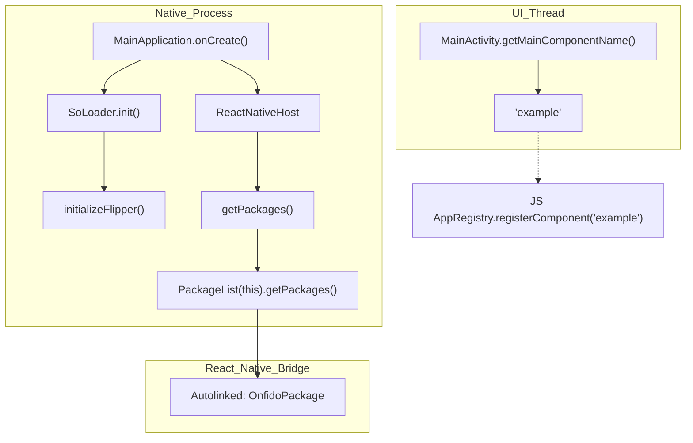
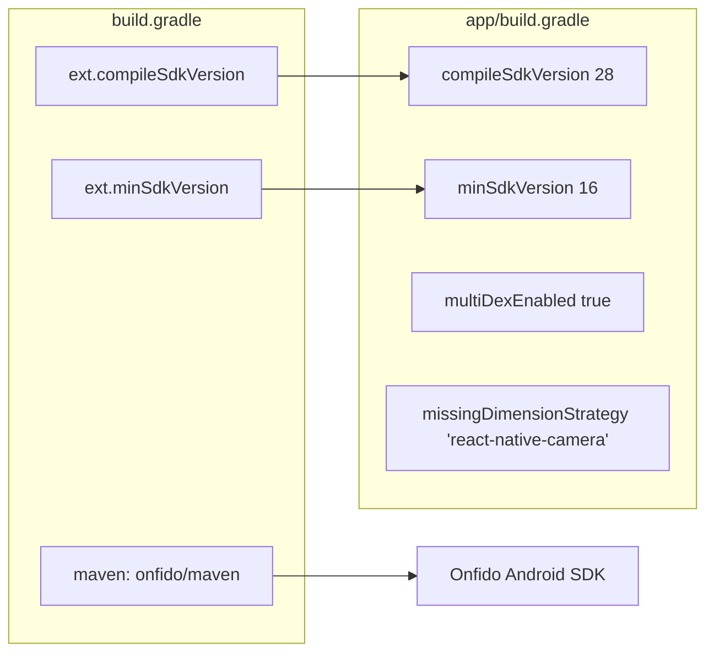

# Example Android Project

# Example Android Project

Relevant source files

The following files were used as context for generating this wiki page:

- [example/android/app/build.gradle](example/android/app/build.gradle)
- [example/android/app/proguard-rules.pro](example/android/app/proguard-rules.pro)
- [example/android/app/src/main/AndroidManifest.xml](example/android/app/src/main/AndroidManifest.xml)
- [example/android/app/src/main/java/com/example/MainActivity.java](example/android/app/src/main/java/com/example/MainActivity.java)
- [example/android/app/src/main/java/com/example/MainApplication.java](example/android/app/src/main/java/com/example/MainApplication.java)
- [example/android/build.gradle](example/android/build.gradle)
- [example/android/settings.gradle](example/android/settings.gradle)

This page details the Android native implementation of the example application within the `react-native-onfido` repository. The example project serves as a functional harness to demonstrate the integration of the Onfido SDK via the React Native bridge.

## Project Structure and Build Configuration

The Android project is structured as a standard Gradle-based React Native application, utilizing a top-level build file and an application-specific module.

### Top-level Gradle Configuration
The root `build.gradle` defines global SDK versions and repository locations. It specifically includes the Onfido Maven repository to resolve the underlying native SDK dependencies.

| Property | Value | Source |
| :--- | :--- | :--- |
| `minSdkVersion` | 16 | [example/android/build.gradle:6-6]() |
| `compileSdkVersion` | 28 | [example/android/build.gradle:7-7]() |
| `targetSdkVersion` | 28 | [example/android/build.gradle:8-8]() |
| `Onfido Maven URL` | `https://dl.bintray.com/onfido/maven` | [example/android/build.gradle:38-38]() |

### App Module Configuration
The `app/build.gradle` file applies the `com.android.application` plugin and configures the React Native CLI integration.

*   **Hermes Support**: Currently disabled by default (`enableHermes: false`) [example/android/app/build.gradle:80-80]().
*   **JS Bundling**: Uses `index.js` as the entry point for the JavaScript bundle [example/android/app/build.gradle:79-79]().
*   **Camera Integration**: Implements a `missingDimensionStrategy` for `react-native-camera` to ensure the 'general' flavor is used during builds [example/android/app/build.gradle:136-136]().
*   **Multidex**: Enabled to support the large method count introduced by the Onfido and React Native dependencies [example/android/app/build.gradle:137-137]().

**Sources:**
* [example/android/build.gradle:1-42]()
* [example/android/app/build.gradle:1-166]()
* [example/android/settings.gradle:1-4]()

## Manifest and Permissions

The `AndroidManifest.xml` defines the necessary hardware and network permissions required for the Onfido SDK to capture documents and perform facial recognition.

### Required Permissions
The application requests the following permissions:
*   `INTERNET`: To communicate with Onfido APIs [example/android/app/src/main/AndroidManifest.xml:4-4]().
*   `CAMERA`: For document and selfie capture [example/android/app/src/main/AndroidManifest.xml:5-5]().
*   `RECORD_AUDIO`: Required for video-based identity checks [example/android/app/src/main/AndroidManifest.xml:6-6]().
*   `READ/WRITE_EXTERNAL_STORAGE`: For handling image data [example/android/app/src/main/AndroidManifest.xml:7-8]().

### Activity Configuration
The `MainActivity` is configured with `configChanges` to prevent the activity from restarting during orientation changes or keyboard visibility toggles, which is critical for maintaining the state of the Onfido flow [example/android/app/src/main/AndroidManifest.xml:20-21]().

**Sources:**
* [example/android/app/src/main/AndroidManifest.xml:1-31]()

## Application Architecture

The Java layer follows the standard React Native lifecycle, initializing the bridge and managing native modules.

### MainApplication.java
This class initializes the React Native `ReactNativeHost` and handles package registration.
*   **Autolinking**: It uses `PackageList` to automatically include the `react-native-onfido` package and other dependencies [example/android/app/src/main/java/com/example/MainApplication.java:25-25]().
*   **Flipper**: Includes a reflection-based initialization for Flipper debugging in debug builds [example/android/app/src/main/java/com/example/MainApplication.java:54-73]().

### MainActivity.java
A simple wrapper extending `ReactActivity`. Its primary responsibility is to return the component name registered in the JavaScript `AppRegistry` [example/android/app/src/main/java/com/example/MainActivity.java:12-14]().

### Data Flow: Native Initialization
The following diagram illustrates how the Android application boots and prepares the React Native environment.

**Android App Bootstrapping**

**Sources:**
* [example/android/app/src/main/java/com/example/MainApplication.java:13-74]()
* [example/android/app/src/main/java/com/example/MainActivity.java:5-15]()

## Build Artifacts and Optimization

### ProGuard Rules
The project includes a `proguard-rules.pro` file. While currently empty of custom rules, it is linked in `build.gradle` for release builds to shrink Java bytecode and obfuscate the application [example/android/app/proguard-rules.pro:1-11]().

### APK Splits
The build configuration supports ABI splitting, allowing for the generation of architecture-specific APKs (armeabi-v7a, x86, arm64-v8a, x86_64) to reduce the final download size [example/android/app/build.gradle:139-146]().

### Resource Management
The application uses standard Android resource directories for icons and themes:
*   **Launcher Icons**: Defined in `res/mipmap` as `ic_launcher` and `ic_launcher_round` [example/android/app/src/main/AndroidManifest.xml:13-14]().
*   **Styles**: Inherits from `AppTheme` [example/android/app/src/main/AndroidManifest.xml:16-16]().

### Dependency Resolution
The following diagram maps the Gradle configuration to the resulting environment.

**Gradle Dependency Mapping**

**Sources:**
* [example/android/app/build.gradle:130-166]()
* [example/android/build.gradle:3-41]()
* [example/android/app/proguard-rules.pro:1-11]()

---