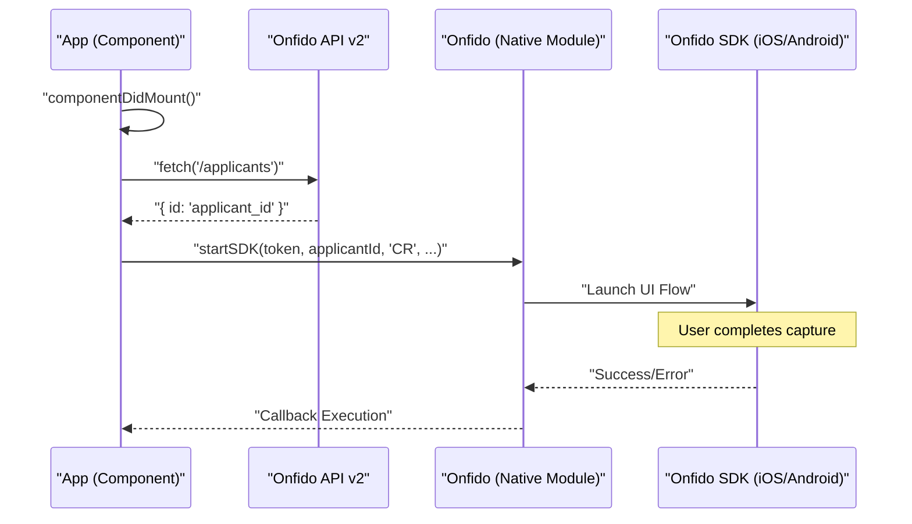
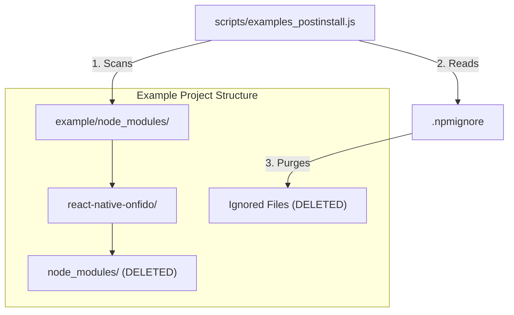

# Example App JavaScript

# Example App JavaScript

Relevant source files

The following files were used as context for generating this wiki page:

- [example/App.js](example/App.js)
- [example/__tests__/App-test.js](example/__tests__/App-test.js)
- [example/babel.config.js](example/babel.config.js)
- [example/index.js](example/index.js)
- [example/metro.config.js](example/metro.config.js)
- [scripts/examples_postinstall.js](scripts/examples_postinstall.js)

The example application serves as a functional integration harness for the `react-native-onfido` library. It demonstrates the end-to-end flow of creating an applicant via the Onfido REST API and subsequently initializing the native SDK flow from JavaScript.

## Application Logic and SDK Orchestration

The core logic resides in `example/App.js`, which manages the lifecycle of an identity verification session. The process is divided into two main phases: provisioning an `applicantId` and invoking the `Onfido.startSDK` method.

### Applicant Creation
The application uses the Onfido API v2 to create a new applicant. This is a required step because the native SDK requires a valid `applicantId` to associate captured documents and media with a specific individual.

- **Function**: `createApplicant` [example/App.js:14-37]()
- **Endpoint**: `https://api.onfido.com/v2/applicants` [example/App.js:19-19]()
- **Method**: `POST` [example/App.js:20-20]()
- **Payload**: Hardcoded identity data for "Jane Doe" [example/App.js:15-18]()

### SDK Invocation
Once the `applicantId` is retrieved, the app calls `Onfido.startSDK`. In this example, the country code is hardcoded to `'CR'` (Costa Rica).

- **Call Site**: `componentDidMount` [example/App.js:40-54]()
- **Parameters**:
    - `token`: SDK Token [example/App.js:42-42]()
    - `applicantId`: Retrieved from the API [example/App.js:43-43]()
    - `country`: Hardcoded to `'CR'` [example/App.js:44-44]()
    - `onSuccess`: Callback logged to console [example/App.js:45-45]()
    - `onError`: Callback handling specific error codes like `USER_LEFT_ACTIVITY` [example/App.js:46-52]()

### Data Flow Diagram: JS to Native
The following diagram illustrates the sequence of events from the React Native component mounting to the native SDK launch.

**Identity Verification Sequence**

**Sources:** [example/App.js:39-55](), [example/App.js:14-37]()

## Entry Point and Configuration

The example app follows standard React Native structure for its entry point and transpilation settings.

| File | Role | Key Detail |
| :--- | :--- | :--- |
| `index.js` | Entry Point | Registers the `App` component using `AppRegistry.registerComponent`. [example/index.js:9-9]() |
| `babel.config.js` | Transpilation | Uses `module:metro-react-native-babel-preset`. [example/babel.config.js:2-2]() |
| `metro.config.js` | Bundler Config | Standard Metro configuration with default transform options. [example/metro.config.js:8-17]() |

**Sources:** [example/index.js:1-10](), [example/babel.config.js:1-3](), [example/metro.config.js:1-18]()

## Post-Install Conflict Resolution

Because the example app references the parent library via a local file dependency (`"react-native-onfido": "file:../"`), the Metro bundler often encounters "duplicate module" errors. This happens because the library's own `node_modules` are symlinked or copied into the example's environment.

The script `scripts/examples_postinstall.js` resolves this by cleaning the library's directory within the example's `node_modules`.

### Cleanup Logic
1. **Identify Path**: Resolves the path to `react-native-onfido` inside the example's `node_modules`. [scripts/examples_postinstall.js:101-103]()
2. **Remove node_modules**: Deletes the nested `node_modules` folder inside the library to prevent Metro from seeing duplicate React/React Native binaries. [scripts/examples_postinstall.js:49-64]()
3. **Apply .npmignore**: Reads the `.npmignore` file and recursively deletes any files or directories listed there that were inadvertently included. [scripts/examples_postinstall.js:67-91]()

**Dependency Cleanup Mapping**

**Sources:** [scripts/examples_postinstall.js:1-112]()

## Testing

The example app includes a basic smoke test to ensure the component tree renders without crashing.

- **File**: `example/__tests__/App-test.js`
- **Tool**: `react-test-renderer` [example/__tests__/App-test.js:10-10]()
- **Test Case**: Uses `renderer.create(<App />)` to verify that the main application component can be instantiated. [example/__tests__/App-test.js:12-14]()

**Sources:** [example/__tests__/App-test.js:1-15]()

---