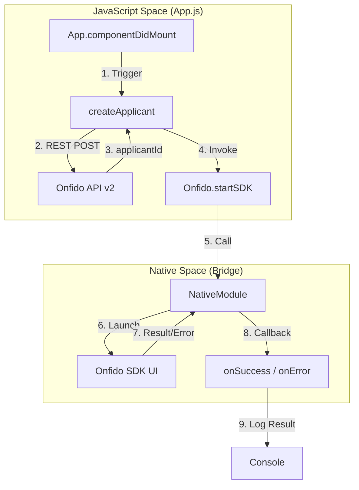
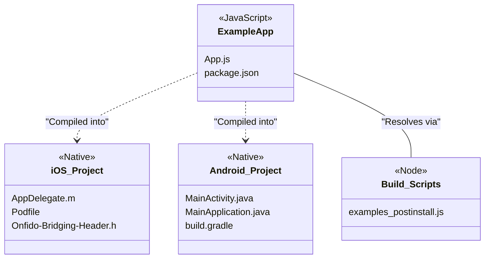

# Example Application

# Example Application

Relevant source files

The following files were used as context for generating this wiki page:

- [example/App.js](example/App.js)
- [example/package.json](example/package.json)
- [example/yarn.lock](example/yarn.lock)

The `example/` directory contains a fully functional React Native application designed to serve as an integration harness for the `react-native-onfido` library. It provides a real-world environment to verify the bridge's functionality, test native configurations, and demonstrate the end-to-end flow from applicant creation to SDK completion.

### Integration as a Local Dependency

The example application does not pull the library from a remote registry like npm. Instead, it references the root project directory as a local file dependency. This allows developers to make changes to the library's native or JavaScript code and test them immediately within the example app without publishing.

| Feature | Implementation |
| :--- | :--- |
| **Dependency Reference** | Defined as `"react-native-onfido": "file:../"` in `package.json` [example/package.json:17-17](). |
| **Dependency Resolution** | A `postinstall` script runs `scripts/examples_postinstall.js` to handle symlink and Metro bundler conflicts [example/package.json:11-11](). |
| **React Native Version** | Built on `react-native` version `0.61.5` [example/package.json:15-15](). |

### System Flow Overview

The following diagram illustrates how the Example Application orchestrates the identity verification process by interacting with both the Onfido REST API and the local native bridge.

**Example App Orchestration Flow**

Sources: [example/App.js:39-55](), [example/App.js:14-37]()

---

### Example App JavaScript
The JavaScript entry point demonstrates how to interact with the Onfido API to prepare the session. It performs a `fetch` call to the Onfido v2 API to generate a `applicant_id` [example/App.js:19-26]() before invoking the SDK bridge. The `startSDK` method is called with hardcoded configuration, including a token and a specific country code (`'CR'`) [example/App.js:41-44]().

For details, see [Example App JavaScript](#4.1).

### Example iOS Project
The iOS implementation within the example directory includes a complete Xcode workspace. It demonstrates the necessary `Podfile` configuration to link the local library and includes local copies of bridging headers and Swift files required for the Onfido SDK to render correctly within a React Native `UIViewController` context.

For details, see [Example iOS Project](#4.2).

### Example Android Project
The Android project provides a standard Gradle setup that includes the necessary `AndroidManifest.xml` permissions and `MainApplication.java` package registration. It highlights the use of ProGuard rules and the `react-native-camera` dimension strategy required for the Onfido capture screens to function on Android devices.

For details, see [Example Android Project](#4.3).

### Component Relationships

The diagram below maps the example application's high-level components to their specific file entities.

**Example Application Component Map**

Sources: [example/package.json:11-18](), [example/App.js:1-5]()

---