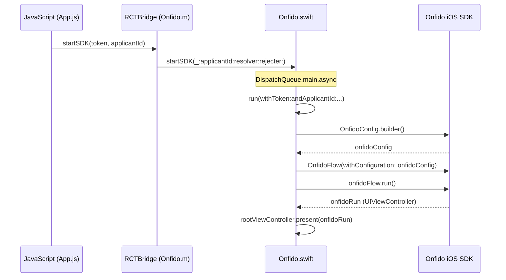
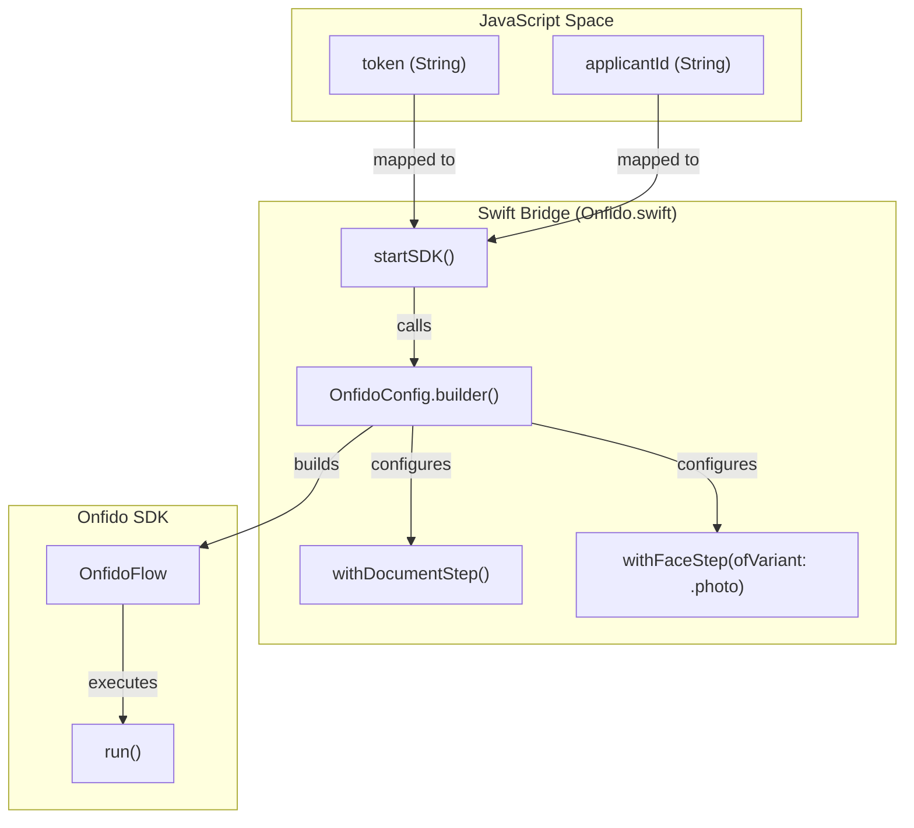

# Example iOS Project

# Example iOS Project

Relevant source files

The following files were used as context for generating this wiki page:

- [example/ios/Podfile](example/ios/Podfile)
- [example/ios/Podfile.lock](example/ios/Podfile.lock)
- [example/ios/example/AppDelegate.h](example/ios/example/AppDelegate.h)
- [example/ios/example/AppDelegate.m](example/ios/example/AppDelegate.m)
- [example/ios/ios/Onfido-Bridging-Header.h](example/ios/ios/Onfido-Bridging-Header.h)
- [example/ios/ios/Onfido.m](example/ios/ios/Onfido.m)
- [example/ios/ios/Onfido.swift](example/ios/ios/Onfido.swift)

The `example/ios/` directory contains a fully functional Xcode workspace designed to demonstrate the integration of the `react-native-onfido` library. This project serves as a reference implementation for configuring the Onfido SDK within a React Native environment, handling CocoaPods dependencies, and managing the native-to-Swift bridge.

## Project Structure and Dependencies

The example project uses CocoaPods for dependency management, specifically targeting iOS 10.0 [example/ios/Podfile:1-1](). It integrates the local version of the library using a relative path [example/ios/Podfile:39-39]().

### CocoaPods Configuration
The `Podfile` ensures that `use_frameworks!` is enabled [example/ios/Podfile:5-5](), which is a requirement for Swift-based native modules like Onfido. The `Podfile.lock` confirms that the example app is pinned to Onfido SDK version `16.1.0` [example/ios/Podfile.lock:22-22]().

| Dependency | Purpose | Source |
| :--- | :--- | :--- |
| `React-Core` | Core React Native framework | [example/ios/Podfile:13-13]() |
| `react-native-onfido` | The local bridge module | [example/ios/Podfile:39-39]() |
| `Onfido` | Native Onfido iOS SDK | [example/ios/Podfile.lock:195-195]() |

**Sources:**
* [example/ios/Podfile:1-48]()
* [example/ios/Podfile.lock:22-195]()

---

## Application Entry Point

The application lifecycle is managed by the `AppDelegate` and `main.m`. The `AppDelegate` initializes the `RCTBridge` to load the JavaScript bundle and sets up the root UI components.

### Implementation Details
* **Bridge Initialization**: The `AppDelegate` implements `RCTBridgeDelegate` [example/ios/example/AppDelegate.h:11-11](). It creates an `RCTBridge` and an `RCTRootView` with the module name "example" [example/ios/example/AppDelegate.m:18-21]().
* **Window Setup**: It manually initializes the `UIWindow` and assigns a `rootViewController` that hosts the `RCTRootView` [example/ios/example/AppDelegate.m:25-28]().
* **Bundle Location**: The `sourceURLForBridge` method determines whether to load the bundle from the Metro bundler (in `DEBUG`) or the pre-compiled `main.jsbundle` [example/ios/example/AppDelegate.m:33-40]().

**Sources:**
* [example/ios/example/AppDelegate.h:11-15]()
* [example/ios/example/AppDelegate.m:16-42]()

---

## Embedded Native Module Copies

A unique aspect of the example project is the presence of an internal `ios/` sub-folder containing copies of the bridge files: `Onfido.swift`, `Onfido.m`, and `Onfido-Bridging-Header.h`. These files allow the example app to test the native bridge logic directly within the workspace.

### The Swift Bridge (`Onfido.swift`)
The `Onfido` class inherits from `NSObject` and is exposed to React Native via the `@objc(Onfido)` attribute [example/ios/ios/Onfido.swift:11-12]().

**Key Functions:**
* **`startSDK`**: The primary entry point called from JavaScript. It ensures the SDK runs on the main thread [example/ios/ios/Onfido.swift:13-20]().
* **`run`**: Orchestrates the `OnfidoConfig` builder. It configures the flow with a Document step and a Face step (photo variant) [example/ios/ios/Onfido.swift:27-32]().
* **`responseHandler`**: A closure that processes `OnfidoResponse`. It maps `.success` to the resolver and `.error` or `.cancel` to the rejecter [example/ios/ios/Onfido.swift:35-47]().
* **`dismiss`**: A helper function that finds the `rootViewController` and dismisses any presented view controllers [example/ios/ios/Onfido.swift:72-74]().

### The Objective-C Macro Bridge (`Onfido.m`)
This file uses React Native's `RCT_EXTERN_MODULE` and `RCT_EXTERN_METHOD` macros to register the Swift class and its methods with the bridge [example/ios/ios/Onfido.m:5-10]().

**Sources:**
* [example/ios/ios/Onfido.swift:11-75]()
* [example/ios/ios/Onfido.m:5-12]()
* [example/ios/ios/Onfido-Bridging-Header.h:4-4]()

---

## Data Flow and Integration

The following diagrams illustrate how the example iOS project connects React Native components to the native Onfido SDK.

### Native Flow Orchestration
This diagram shows the sequence of events when `startSDK` is invoked.

**Sources:**
* [example/ios/ios/Onfido.swift:13-57]()
* [example/ios/ios/Onfido.m:7-10]()

### Entity Mapping: JS to Native
This diagram maps the JavaScript arguments to the corresponding Swift types and Onfido SDK configuration methods.

**Sources:**
* [example/ios/ios/Onfido.swift:13-34]()
* [example/ios/ios/Onfido.m:7-10]()

---

## Target Support
The workspace includes support for standard iOS targets as well as tvOS targets, although the Onfido SDK functionality is primarily intended for mobile iOS devices due to camera requirements.

* **example**: Main iOS application target [example/ios/Podfile:4-4]().
* **exampleTests**: Unit testing target inheriting search paths from the main app [example/ios/Podfile:42-45]().
* **example-tvOS**: A target for Apple TV support [example/ios/Podfile:50-50]().

**Sources:**
* [example/ios/Podfile:4-58]()

---