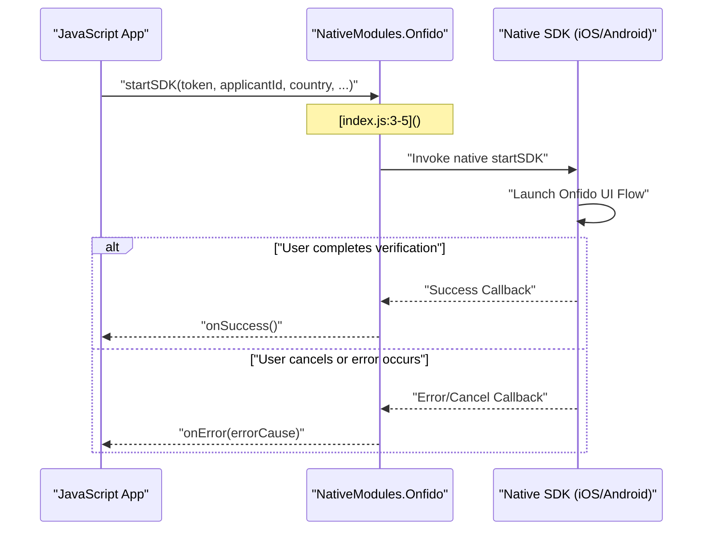
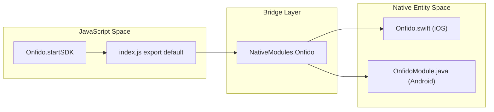

# Getting Started

# Getting Started

<details>
<summary>Relevant source files</summary>

The following files were used as context for generating this wiki page:

- [README.md](README.md)
- [index.js](index.js)
- [package.json](package.json)

</details>


This guide provides a step-by-step walkthrough for installing and integrating the `react-native-onfido` library into your React Native project. The library acts as a bridge between React Native and the native Onfido SDKs for iOS and Android, enabling identity verification flows within your mobile application.

## Installation

The library can be added to your project using `yarn` or `npm`. It supports autolinking for React Native versions 0.60.0 and above.

```bash
# Using yarn
yarn add react-native-onfido

# Using npm
npm install react-native-onfido --save
```

### Peer Dependencies
Ensure your project meets the following version requirements for compatibility:
* **React**: `^16.8.1` [package.json:22-22]()
* **React Native**: `>=0.60.0-rc.0 <1.0.x` [package.json:23-23]()

### Autolinking
Since this library targets React Native `>=0.60.0`, the native modules are automatically linked to your project. For iOS, you must install the pods after adding the package:

```bash
cd ios && pod install
```

Sources: [package.json:1-36](), [README.md:28-30]()

## Integration Flow

The integration relies on the `NativeModules` bridge to pass configuration data from JavaScript to the native Onfido SDK implementations.

### Data Flow Diagram
The following diagram illustrates the initialization sequence from the JavaScript environment to the native SDKs.

**Onfido SDK Initialization Sequence**


Sources: [index.js:1-5](), [README.md:34-65]()

## Minimal Usage Example

To start the Onfido KYC process, import the module and call `startSDK`. This function requires a session token and an applicant ID (usually generated via your backend using the Onfido API).

### Implementation

```javascript
import Onfido from 'react-native-onfido';

const token = "YOUR_ONFIDO_SDK_TOKEN";
const applicantId = "YOUR_APPLICANT_ID";
const country = "USA"; // ISO 3166-1 alpha-3 code

Onfido.startSDK(
    token,
    applicantId,
    country,
    () => { 
        // Verification complete
        console.log("Verification complete");
    },
    (errorCause) => {
        // Handle cancellation or failure
        if (errorCause === "USER_LEFT_ACTIVITY") {
            console.log("Flow cancelled by user");
        } else {
            console.log("Flow failed:", errorCause);
        };
    },
    "#FF0000" // Optional: primaryColor for iOS UI customization
);
```

### Code Entity Mapping
This diagram bridges the JavaScript API calls to the underlying `NativeModules` architecture.

**JS to Native Bridge Mapping**


### Parameter Reference
| Parameter | Type | Description |
| :--- | :--- | :--- |
| `token` | `string` | The mobile SDK token generated by your backend. |
| `applicantId` | `string` | The ID of the applicant being verified. |
| `country` | `string` | The 3-letter ISO country code (e.g., "GBR", "USA"). |
| `onSuccess` | `function` | Callback triggered when the user completes the flow. |
| `onError` | `function` | Callback triggered on error or cancellation (returns `errorCause`). |
| `primaryColor` | `string` | (Optional, iOS only) Hex string to customize the SDK theme. |

Sources: [index.js:1-5](), [README.md:34-65]()

---