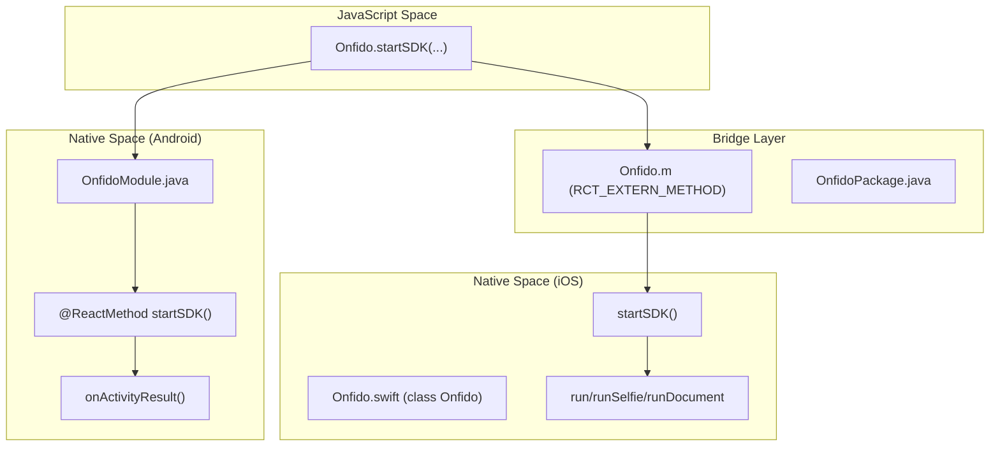
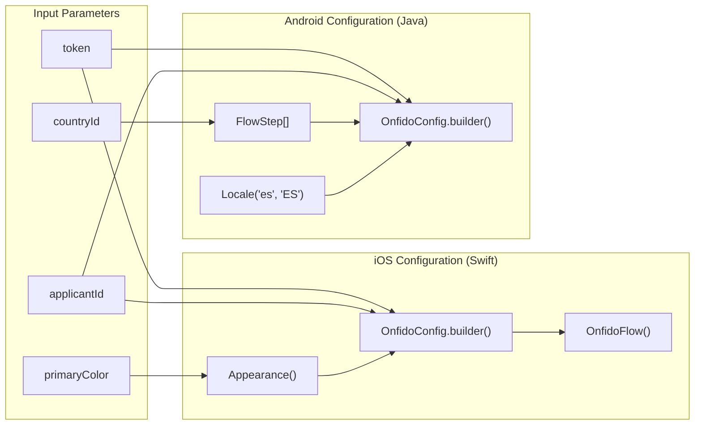

# Glossary

# Glossary

Relevant source files

The following files were used as context for generating this wiki page:

- [README.md](README.md)
- [android/build.gradle](android/build.gradle)
- [android/src/main/java/com/reactlibrary/OnfidoModule.java](android/src/main/java/com/reactlibrary/OnfidoModule.java)
- [example/yarn.lock](example/yarn.lock)
- [ios/Onfido.m](ios/Onfido.m)
- [ios/Onfido.swift](ios/Onfido.swift)
- [package.json](package.json)
- [react-native-onfido.podspec](react-native-onfido.podspec)

This page provides a comprehensive reference for the technical terminology, architectural components, and domain-specific concepts used within the `react-native-onfido` codebase. It serves as a bridge between the high-level React Native API and the underlying native SDK implementations for iOS and Android.

## Core Concepts & Domain Vocabulary

### SDK Identity & Flow
*   **Applicant ID**: A unique identifier generated via the Onfido API representing the individual undergoing identity verification [ios/Onfido.swift:8-8](), [android/src/main/java/com/reactlibrary/OnfidoModule.java:78-78]().
*   **SDK Token**: A short-lived JWT (JSON Web Token) used to authenticate the mobile SDK session with Onfido's backend [ios/Onfido.swift:7-7]().
*   **Flow Type**: A string parameter (`full`, `selfie`, or `document`) that determines which verification steps the user must complete [ios/Onfido.swift:14-23](), [android/src/main/java/com/reactlibrary/OnfidoModule.java:92-127]().
*   **USER_LEFT_ACTIVITY**: A specific error string returned to the JavaScript layer when a user manually cancels or exits the Onfido flow before completion [ios/Onfido.swift:65-65](), [README.md:57-58]().

### Verification Steps
*   **Document Step**: The portion of the flow where a user captures a physical ID (e.g., National Identity Card) [ios/Onfido.swift:50-50]().
*   **Face Step / Selfie**: The portion of the flow where a user captures a photo of their face to compare against the provided document [ios/Onfido.swift:51-51](), [android/src/main/java/com/reactlibrary/OnfidoModule.java:95-95]().

**Sources:** [ios/Onfido.swift:1-100](), [android/src/main/java/com/reactlibrary/OnfidoModule.java:78-130](), [README.md:49-65]()

---

## React Native Bridge Entities

The library utilizes the standard React Native Bridge pattern to communicate between JavaScript and Native code.

### Code Entity Mapping: JS to Native
The following diagram maps the JavaScript call site to the corresponding native implementations.

**Natural Language to Code Entity Space: Bridge Execution**

**Sources:** [ios/Onfido.m:4-15](), [ios/Onfido.swift:4-12](), [android/src/main/java/com/reactlibrary/OnfidoModule.java:33-78]()

### Key Classes and Functions

| Entity | Platform | Description |
| :--- | :--- | :--- |
| `Onfido` | iOS (Swift) | The main native class annotated with `@objc(Onfido)` to expose it to React Native [ios/Onfido.swift:4-5](). |
| `OnfidoModule` | Android (Java) | Extends `ReactContextBaseJavaModule`, handling the intent lifecycle and result callbacks [android/src/main/java/com/reactlibrary/OnfidoModule.java:33-33](). |
| `RCTResponseSenderBlock` | iOS (Swift) | The callback type used to send success/error data back to JavaScript [ios/Onfido.swift:11-12](). |
| `ActivityEventListener` | Android (Java) | Listens for the Onfido Activity completion to trigger `userCompleted` or `userExited` logic [android/src/main/java/com/reactlibrary/OnfidoModule.java:42-42](). |

**Sources:** [ios/Onfido.swift:4-12](), [android/src/main/java/com/reactlibrary/OnfidoModule.java:33-42]()

---

## SDK Configuration & Data Flow

The library translates a simple JS object into complex configuration builders required by the Onfido Capture SDK.

### Configuration Mapping
The following diagram illustrates how parameters passed from JavaScript are used to build the native `OnfidoConfig`.

**Code Entity Space: Configuration Builder Data Flow**

**Sources:** [ios/Onfido.swift:39-55](), [android/src/main/java/com/reactlibrary/OnfidoModule.java:91-127]()

### Implementation Details

*   **Appearance Customization**: On iOS, the `primaryColor` hex string is converted via `colorWithHexString` to style the `Appearance` object [ios/Onfido.swift:39-44]().
*   **Hardcoded Locales**: On Android, the SDK is currently initialized with a hardcoded Spanish locale (`es`, `ES`) [android/src/main/java/com/reactlibrary/OnfidoModule.java:101-101]().
*   **Document Type Mapping**: The Android implementation maps the `countryCode` to a `CaptureScreenStep` using `DocumentType.NATIONAL_IDENTITY_CARD` [android/src/main/java/com/reactlibrary/OnfidoModule.java:94-94]().
*   **Modal Presentation**: On iOS, the flow is presented using `modalPresentationStyle = .fullScreen` on the application's root view controller [ios/Onfido.swift:72-73]().

**Sources:** [ios/Onfido.swift:39-73](), [android/src/main/java/com/reactlibrary/OnfidoModule.java:94-128]()