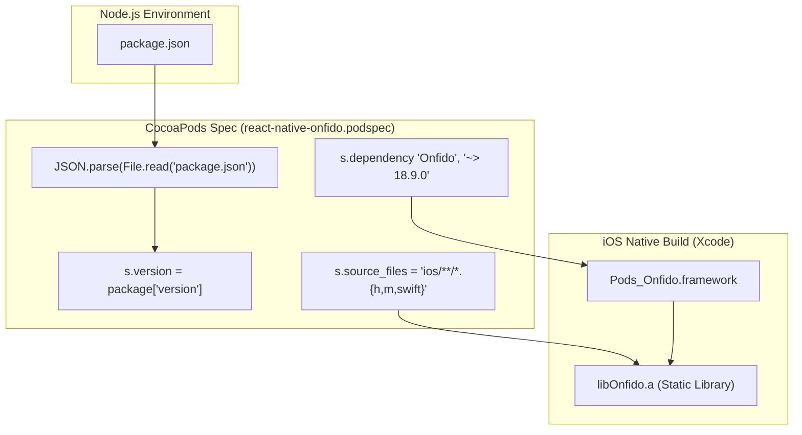
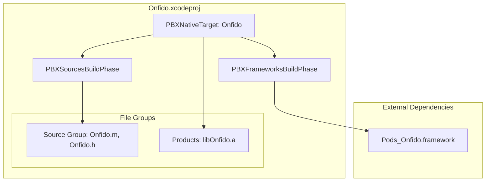

# iOS Build Configuration

# iOS Build Configuration

Relevant source files

The following files were used as context for generating this wiki page:

- [ios/Onfido.xcodeproj/project.pbxproj](ios/Onfido.xcodeproj/project.pbxproj)
- [ios/Onfido.xcworkspace/contents.xcworkspacedata](ios/Onfido.xcworkspace/contents.xcworkspacedata)
- [react-native-onfido.podspec](react-native-onfido.podspec)

This page details the build-time configuration for the iOS platform of the `react-native-onfido` library. The primary mechanism for dependency management and build orchestration on iOS is CocoaPods, defined via the library's podspec.

## CocoaPods Specification (`react-native-onfido.podspec`)

The `react-native-onfido.podspec` file defines how the native iOS module is compiled and integrated into a host React Native application. It manages metadata synchronization from the package root, defines minimum platform requirements, and pins external SDK dependencies.

### Version Synchronization
The podspec dynamically reads metadata from the `package.json` file located in the project root [react-native-onfido.podspec:1-3](). This ensures that the version, summary, and description of the CocoaPod remain in sync with the npm package version [react-native-onfido.podspec:7-8]().

### Platform and Language Requirements
The library targets modern iOS environments with the following constraints:
*   **Minimum Deployment Target**: iOS 10.0 [react-native-onfido.podspec:16-16]().
*   **Swift Version**: Swift 4.2 [react-native-onfido.podspec:17-17]().
*   **Memory Management**: Automatic Reference Counting (ARC) is required [react-native-onfido.podspec:21-21]().

### Dependency Management
The library relies on two primary dependencies to function:
1.  **React**: The core React Native library [react-native-onfido.podspec:23-23]().
2.  **Onfido SDK**: The native Onfido iOS SDK is pinned to version `~> 18.9.0` [react-native-onfido.podspec:24-24](). This ensures compatibility with the bridge implementation while allowing for non-breaking patch and minor updates.

### Source Files
The podspec uses a glob pattern to include all header (`.h`), implementation (`.m`), and Swift (`.swift`) files located within the `ios` directory [react-native-onfido.podspec:20-20]().

**Sources:**
*   [react-native-onfido.podspec:1-25]()

---

## Build Pipeline Architecture

The following diagram illustrates the relationship between the `package.json` metadata, the `podspec` configuration, and the final native library output.

### Metadata and Dependency Flow
"This diagram bridges the Natural Language Space of 'package configuration' to the Code Entity Space of 'CocoaPods specifications'."

**Sources:**
*   [react-native-onfido.podspec:3-24]()
*   [ios/Onfido.xcodeproj/project.pbxproj:101-103]()

---

## Xcode Project Configuration

The native project is structured as a static library that is eventually linked into the consumer's application.

### Build Phases and Artifacts
The Xcode project defines a static library target named `Onfido` [ios/Onfido.xcodeproj/project.pbxproj:87-104]().

| Entity | Code Identifier | Description |
| :--- | :--- | :--- |
| **Product Name** | `libOnfido.a` | The resulting static library archive [ios/Onfido.xcodeproj/project.pbxproj:27-27](). |
| **Product Type** | `com.apple.product-type.library.static` | Defined as a static library for compatibility with React Native's autolinking [ios/Onfido.xcodeproj/project.pbxproj:103-103](). |
| **ARC Toggle** | `CLANG_ENABLE_OBJC_ARC` | Set to `YES` to ensure modern memory management [ios/Onfido.xcodeproj/project.pbxproj:180-180](). |
| **Source Phase** | `Sources` | Includes implementation files like `Onfido.m` [ios/Onfido.xcodeproj/project.pbxproj:162-170](). |

### Workspace Integration
The library uses an `.xcworkspace` to manage the relationship between the primary library project and the CocoaPods-generated `Pods.xcodeproj` [ios/Onfido.xcworkspace/contents.xcworkspacedata:1-10]().

### Project Structure Diagram
"This diagram maps the file system structure to the Xcode internal PBXGroup and Target entities."

**Sources:**
*   [ios/Onfido.xcodeproj/project.pbxproj:46-54]()
*   [ios/Onfido.xcodeproj/project.pbxproj:87-104]()
*   [ios/Onfido.xcodeproj/project.pbxproj:162-170]()
*   [ios/Onfido.xcworkspace/contents.xcworkspacedata:4-9]()

---