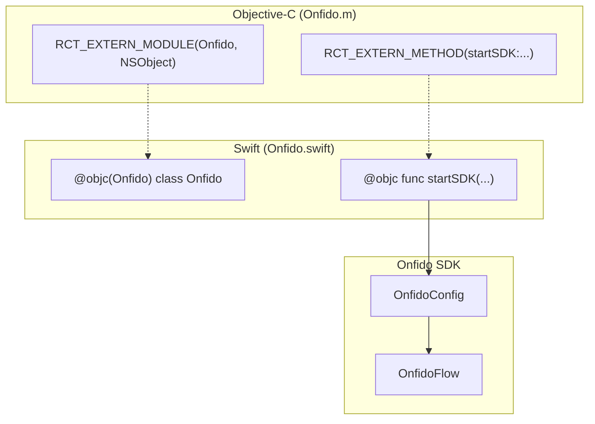
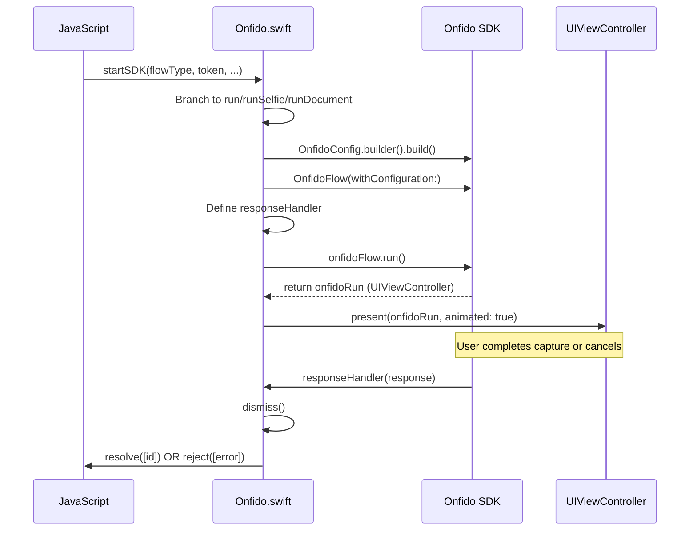

# iOS Native Module

# iOS Native Module

Relevant source files

The following files were used as context for generating this wiki page:

- [ios/Onfido-Bridging-Header.h](ios/Onfido-Bridging-Header.h)
- [ios/Onfido.m](ios/Onfido.m)
- [ios/Onfido.swift](ios/Onfido.swift)
- [react-native-onfido.podspec](react-native-onfido.podspec)

The iOS implementation of the `react-native-onfido` library provides a bridge between the React Native environment and the Onfido iOS SDK. It leverages Swift for the core orchestration logic and Objective-C macros to expose the module to the React Native bridge.

## Bridge Architecture

The bridge consists of three primary components that allow JavaScript to communicate with the native Swift code:

1.  **`Onfido-Bridging-Header.h`**: Exposes React Native's `RCTBridgeModule` to Swift [ios/Onfido-Bridging-Header.h:4-4]().
2.  **`Onfido.m`**: Uses React Native's export macros (`RCT_EXTERN_MODULE` and `RCT_EXTERN_METHOD`) to register the Swift class and its methods with the bridge [ios/Onfido.m:4-15]().
3.  **`Onfido.swift`**: The main implementation class that handles SDK configuration, UI presentation, and result handling [ios/Onfido.swift:5-12]().

### Bridge Connectivity Diagram

The following diagram illustrates how the code entities connect across the language boundary.

**Bridge Entity Mapping**

Sources: [ios/Onfido.m:4-15](), [ios/Onfido.swift:4-12](), [ios/Onfido.swift:46-55]()

## Flow Orchestration

The module entry point is the `startSDK` method. This method executes on the main thread [ios/Onfido.swift:13-13]() and branches into different flow types based on the `flowType` string passed from JavaScript.

### Execution Paths

| Flow Type | Internal Method | Description |
| :--- | :--- | :--- |
| `full` | `run(...)` | Includes both Document capture and Face (Selfie) capture [ios/Onfido.swift:15-16](). |
| `selfie` | `runSelfie(...)` | Includes only the Face capture step [ios/Onfido.swift:17-18](). |
| `document` | `runDocument(...)` | Includes only the Document capture step [ios/Onfido.swift:19-20](). |

### Flow Lifecycle Diagram

This diagram shows the lifecycle of an `OnfidoFlow` within the native module.

**Onfido Lifecycle & UI Presentation**

Sources: [ios/Onfido.swift:13-25](), [ios/Onfido.swift:46-73](), [ios/Onfido.swift:56-68]()

## Implementation Details

### Configuration and Appearance
The `OnfidoConfig` is constructed using a builder pattern. The module applies a custom `Appearance` object to style the SDK UI [ios/Onfido.swift:39-44](). The `primaryColor` is dynamically passed from JavaScript, while other colors (like `primaryTitleColor` or background states) are currently hardcoded in the Swift implementation [ios/Onfido.swift:40-43]().

### UI Presentation
The SDK's view controller is presented modally over the application's root view controller:
*   The `modalPresentationStyle` is set to `.fullScreen` [ios/Onfido.swift:72-72]().
*   It targets `UIApplication.shared.windows.first?.rootViewController` for presentation [ios/Onfido.swift:73-73]().

### Error and Cancel Handling
The `responseHandler` closure handles the three possible outcomes from the SDK [ios/Onfido.swift:56-57]():

1.  **`.success`**: The module calls `dismiss()` and resolves the promise with the `applicantId` [ios/Onfido.swift:61-63]().
2.  **`.cancel`**: The module rejects the promise with the string `"USER_LEFT_ACTIVITY"` and dismisses the UI [ios/Onfido.swift:64-66]().
3.  **`.error`**: The module dismisses the UI and rejects the promise with the localized error description [ios/Onfido.swift:58-60]().

Additionally, the `try-catch` block around `onfidoFlow.run()` handles initialization errors such as missing permissions [ios/Onfido.swift:74-83]().

| Native Error | Rejection Code |
| :--- | :--- |
| `OnfidoFlowError.cameraPermission` | `"cameraPermission"` |
| `OnfidoFlowError.microphonePermission` | `"microphonePermission"` |
| Generic Catch | `"Error"` |

Sources: [ios/Onfido.swift:56-83](), [ios/Onfido.swift:111-138]()

## Build Requirements

The iOS module requires the following environment as defined in the podspec:
*   **iOS Deployment Target**: 10.0 [react-native-onfido.podspec:16-16]()
*   **Swift Version**: 4.2 [react-native-onfido.podspec:17-17]()
*   **Onfido SDK Dependency**: `~> 18.9.0` [react-native-onfido.podspec:24-24]()

Sources: [react-native-onfido.podspec:1-25]()

---