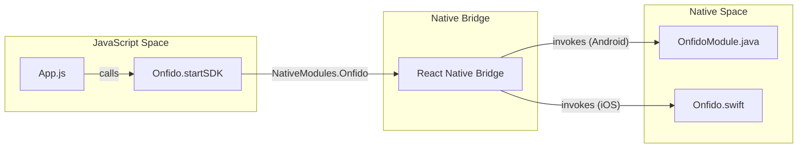
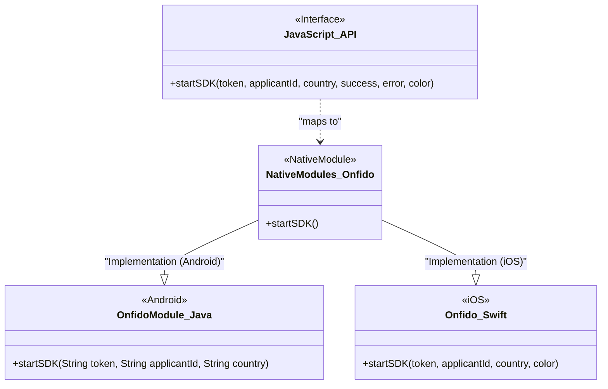

# JavaScript API Reference

# JavaScript API Reference

<details>
<summary>Relevant source files</summary>

The following files were used as context for generating this wiki page:

- [README.md](README.md)
- [index.js](index.js)
- [package.json](package.json)

</details>


This page provides a detailed reference for the public JavaScript surface of the `react-native-onfido` library. It describes the bridge between React Native and the native Onfido SDKs, detailing the function signatures, parameters, and error handling mechanisms.

## Overview

The JavaScript layer of `react-native-onfido` acts as a thin wrapper around the `NativeModules` provided by React Native. It exposes a single primary function, `startSDK`, which orchestrates the transition from the React Native environment to the native Onfido flow on both iOS and Android.

### Data Flow: JS to Native

The following diagram illustrates how a call from the JavaScript application reaches the native implementations.

**Bridge Communication Flow**

**Sources:**
- [index.js:1-5]()
- [README.md:49-65]()

---

## Module Export

The library's entry point exports the `Onfido` native module directly.

| Entity | Type | Description |
| :--- | :--- | :--- |
| `Onfido` | `NativeModule` | The bridge object containing the `startSDK` method. |

**Sources:**
- [index.js:1-5]()
- [package.json:6-6]()

---

## startSDK

The `startSDK` function is the primary method used to initiate the Onfido identity verification process (KYC).

### Function Signature

```javascript
Onfido.startSDK(
    token, 
    applicantId, 
    country, 
    onSuccess, 
    onError, 
    primaryColor
);
```

### Parameters

| Parameter | Type | Required | Description |
| :--- | :--- | :--- | :--- |
| `token` | `string` | Yes | The Onfido SDK token generated from your backend. |
| `applicantId` | `string` | Yes | The ID of the applicant for whom the check is being performed. |
| `country` | `string` | Yes | The 3-letter ISO country code (e.g., `"GBR"`, `"USA"`, `"CR"`) for the document to be captured. |
| `onSuccess` | `function` | Yes | Callback function executed when the flow completes successfully. |
| `onError` | `function` | Yes | Callback function executed when the flow fails or is cancelled. Receives an `errorCause` string. |
| `primaryColor` | `string` | No | (iOS Only) Hex code or color name to customize the primary action buttons and UI elements. |

**Sources:**
- [README.md:37-38]()
- [README.md:49-64]()

---

## Error Handling

The `onError` callback provides feedback when the SDK flow does not reach a successful completion. This includes both technical errors and user-initiated cancellations.

### Error Codes

The library standardizes certain error strings passed to the `onError` callback:

| Error String | Description |
| :--- | :--- |
| `USER_LEFT_ACTIVITY` | The user manually exited the Onfido flow (e.g., by pressing the back button on Android or the close button on iOS). |
| *Other Strings* | Technical error messages originating from the underlying Onfido SDK (e.g., network issues or invalid tokens). |

### Example Implementation

```javascript
Onfido.startSDK(
    token,
    applicantId,
    country,
    () => { 
        console.log("Verification complete");
    },
    (errorCause) => {
        if (errorCause === "USER_LEFT_ACTIVITY") {
            console.log("The user cancelled the flow.");
        } else {
            console.error("An error occurred:", errorCause);
        };
    }
);
```

**Sources:**
- [README.md:56-62]()

---

## Code Entity Mapping

The following diagram maps the JavaScript function call to the specific native classes responsible for handling the execution.

**Entity Mapping: JS to Native Implementation**


**Sources:**
- [index.js:3-5]()
- [README.md:34-38]()
- [package.json:2-6]()

---