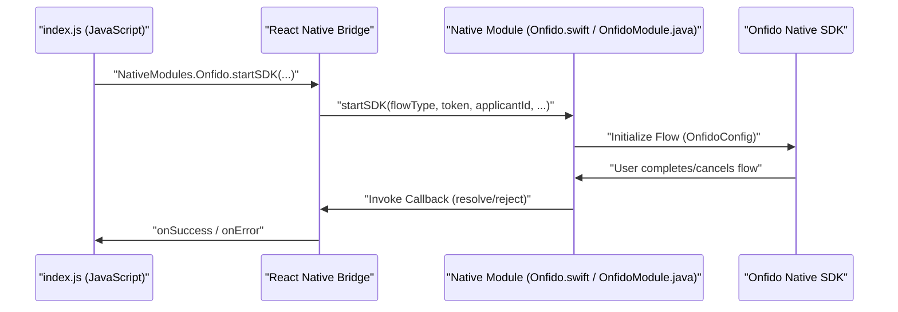
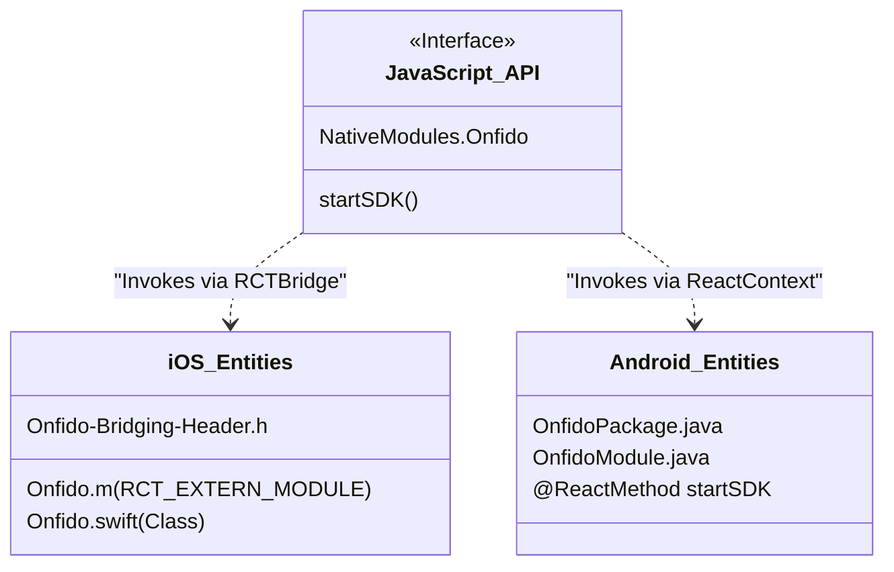

# Native Bridge Architecture

# Native Bridge Architecture

Relevant source files

The following files were used as context for generating this wiki page:

- [android/src/main/java/com/reactlibrary/OnfidoPackage.java](android/src/main/java/com/reactlibrary/OnfidoPackage.java)
- [ios/Onfido-Bridging-Header.h](ios/Onfido-Bridging-Header.h)
- [ios/Onfido.m](ios/Onfido.m)

This page provides a high-level overview of the bridge architecture used by `react-native-onfido` to facilitate communication between JavaScript and the native Onfido SDKs for iOS and Android.

The library acts as a thin wrapper that translates React Native method calls into native execution flows. By utilizing the standard React Native bridge pattern, it ensures that identity verification flows (document capture, face scans) are handled entirely by the high-performance native SDKs provided by Onfido, while the configuration and results remain accessible to the JavaScript application layer.

## Architectural Overview

The architecture follows the standard React Native Native Module pattern. The JavaScript layer calls a single unified method, `startSDK`, which is then dispatched to platform-specific implementations.

### Communication Flow
The diagram below illustrates how a call from the JavaScript environment reaches the native Onfido SDK and returns a result.

**Bridge Control Flow**

**Sources:** [ios/Onfido.m:6-14](), [android/src/main/java/com/reactlibrary/OnfidoModule.java:54-61]()

## Platform Implementations

The bridge is implemented using platform-specific languages (Swift/Objective-C for iOS and Java for Android) to interface directly with the Onfido SDK binaries.

### iOS Implementation
The iOS side uses a mix of Swift and Objective-C. The core logic resides in `Onfido.swift`, while the bridge exposure is handled via Objective-C macros.

*   **Bridge Header:** The `Onfido-Bridging-Header.h` imports `RCTBridgeModule.h` to allow Swift to communicate with React Native [ios/Onfido-Bridging-Header.h:4-4]().
*   **Module Exposure:** The `RCT_EXTERN_MODULE` macro in `Onfido.m` registers the `Onfido` class with the React Native bridge [ios/Onfido.m:4-4]().
*   **Method Mapping:** The `startSDK` method is exposed to JavaScript using `RCT_EXTERN_METHOD`, mapping JS arguments like `flowType`, `token`, and `applicantId` to native Swift types [ios/Onfido.m:6-14]().

For a deep dive into the iOS lifecycle, UI presentation, and error handling, see **[iOS Native Module](#2.1)**.

### Android Implementation
The Android side is implemented in Java and follows the `ReactContextBaseJavaModule` pattern.

*   **Module Registration:** The `OnfidoPackage` class implements `ReactPackage` and adds `OnfidoModule` to the list of native modules available to the React Native instance [android/src/main/java/com/reactlibrary/OnfidoPackage.java:13-17]().
*   **Method Invocation:** The `OnfidoModule` class defines the `@ReactMethod startSDK`, which handles the incoming configuration and launches the Onfido `Activity` [android/src/main/java/com/reactlibrary/OnfidoModule.java:54-55]().
*   **Result Handling:** It implements `ActivityEventListener` to listen for the SDK's result once the verification activity finishes.

For a deep dive into Android intent handling, locale configuration, and callback routing, see **[Android Native Module](#2.2)**.

## Data Mapping

The bridge is responsible for converting JavaScript types into the strongly-typed objects required by the Onfido SDKs.

| JavaScript Argument | iOS Native Type | Android Native Type | Description |
| :--- | :--- | :--- | :--- |
| `flowType` | `NSString` | `String` | Determines the SDK flow (e.g., "all", "document"). |
| `token` | `NSString` | `String` | Onfido Mobile SDK Token. |
| `applicantId` | `NSString` | `String` | The ID of the applicant created via Onfido API. |
| `countryId` | `NSString` | `String` | ISO 3166-1 alpha-3 country code. |
| `primaryColor` | `NSString` | `String` | Hex code for UI customization. |

**Sources:** [ios/Onfido.m:6-14](), [android/src/main/java/com/reactlibrary/OnfidoModule.java:55-61]()

## Entity Mapping: JS to Native

The following diagram maps the JavaScript interface entities to their respective native counterparts across both platforms.

**Entity Association Map**

**Sources:** [ios/Onfido.m:4-15](), [android/src/main/java/com/reactlibrary/OnfidoPackage.java:13-23](), [android/src/main/java/com/reactlibrary/OnfidoModule.java:54-61]()

---