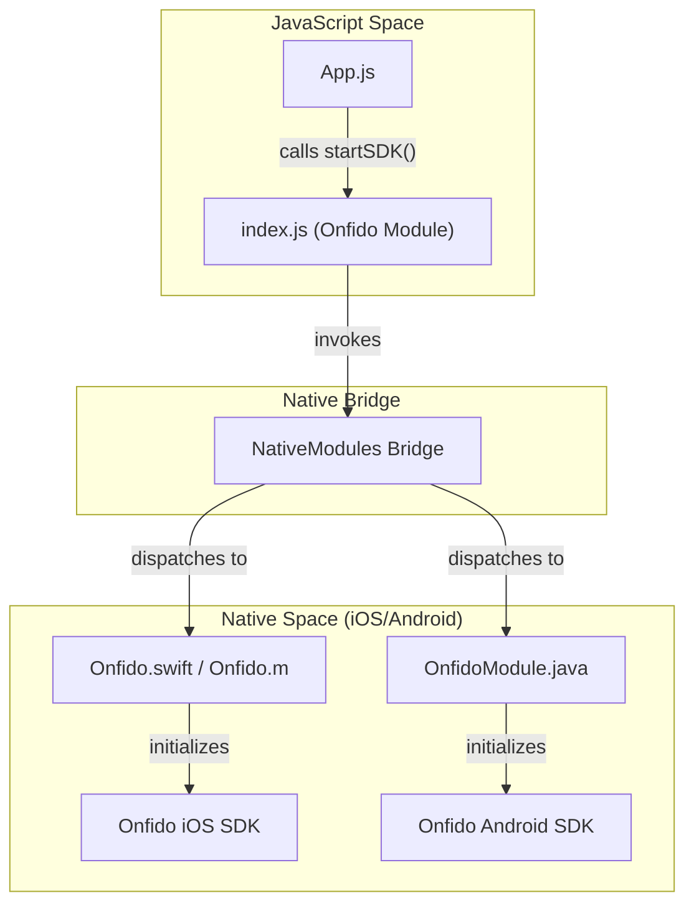
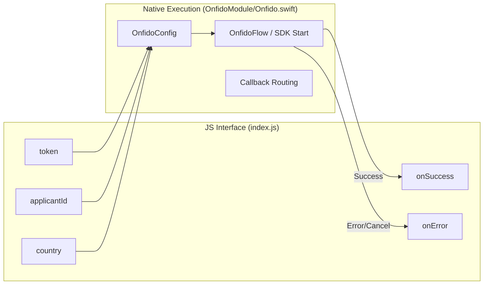

# Overview

# Overview

Relevant source files

The following files were used as context for generating this wiki page:

- [LICENSE](LICENSE)
- [README.md](README.md)
- [package.json](package.json)

`react-native-onfido` is a React Native wrapper for the [Onfido SDK](https://onfido.com/), providing identity verification and Know Your Customer (KYC) capabilities to mobile applications. It allows developers to integrate Onfido's document and facial verification flows into their React Native projects using a unified JavaScript interface.

The library acts as a bridge, orchestrating communication between the React Native environment and the native Onfido SDKs for iOS and Android.

### System Integration Map

The following diagram illustrates how the `react-native-onfido` library bridges the JavaScript application layer with the underlying native SDKs.

**High-Level Architecture Overview**

Sources: [package.json:1-6](), [README.md:16-17](), [README.md:47-65]()

---

## Core Functionality

The primary entry point for the library is the `startSDK` function. This function triggers the native UI flow provided by Onfido, which handles document capture, selfie capture, and data transmission to Onfido's servers.

### Functional Data Flow

This diagram maps the JavaScript function call parameters to the native implementation logic.

**JavaScript to Native Parameter Mapping**

Sources: [README.md:34-38](), [README.md:49-65]()

---

## Ecosystem Fit

`react-native-onfido` is designed for modern React Native environments (0.60+).

- **Peer Dependencies**: Requires `react` (^16.8.1) and `react-native` (>=0.60.0). [package.json:21-24]()
- **Native Linkage**: Utilizes autolinking for both iOS (via CocoaPods) and Android (via Gradle).
- **License**: Distributed under the MIT License. [LICENSE:1-21]()

---

## Documentation Map

The documentation is organized into several sections covering installation, API details, native implementation, and build configuration.

### 1.1 [Getting Started](#1.1)
A step-by-step guide for installing the library via `npm` or `yarn`. It covers the initial setup requirements, including peer dependency checks and the minimum code required to launch the Onfido verification flow.
For details, see [Getting Started](#1.1).

### 1.2 [JavaScript API Reference](#1.2)
Detailed documentation for the `Onfido` object exported by the library. This section defines the `startSDK` function signature, parameter types (such as `applicantId` and `primaryColor`), and explains the error handling logic, including specific codes like `USER_LEFT_ACTIVITY`.
For details, see [JavaScript API Reference](#1.2).

### 2. Native Bridge Architecture
Deep dives into the platform-specific implementations.
- **iOS Native Module**: Details on `Onfido.swift` and the `RCT_EXTERN_MODULE` bridge.
- **Android Native Module**: Details on `OnfidoModule.java` and `ActivityEventListener` integration.

### 3. Build & Configuration
Information on the build systems and dependency pinning.
- **iOS Build**: Covers the `.podspec` and Onfido iOS SDK versioning.
- **Android Build**: Covers `build.gradle` and the Onfido Android Capture SDK dependencies.

### 4. Example Application
Overview of the included `example/` directory, which demonstrates a full integration, including a mock backend call to create an applicant before starting the SDK.

### 5. Contributing & Community
Guidelines for contributing to the project and the code of conduct for maintainers and contributors.

---
Sources: [package.json:33-35](), [README.md:19-25](), [README.md:67-73]()

---